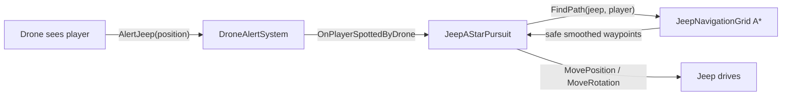
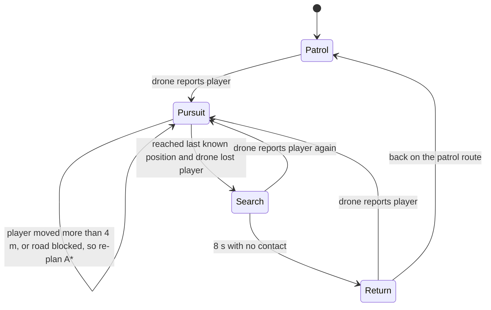

# Drone-guided A* jeep pursuit (Intelligent Systems part)

When the surveillance drone sees the player soldier, it sends the player's position to the patrol jeep. The jeep leaves its perimeter patrol and uses **A\* search** to plan the quickest, easiest route there without hitting anything. It drives that route, stops a safe distance from the soldier, searches the last known position if the drone loses him, and then drives back to its patrol road.

## Files

| File | Role |
|---|---|
| `Assets/Scripts/AI/Jeep/JeepNavigationGrid.cs` | Builds the search space (grid, clearance and cost map) and runs **A\*** with path smoothing |
| `Assets/Scripts/AI/Jeep/JeepAStarPursuit.cs` | Jeep agent: receives drone messages, runs the state machine, follows the path and avoids collisions. Also contains the runtime bootstrap |
| `Assets/Scripts/AI/Jeep/DronePlayerSurveillance.cs` | Drone "eyes": sends the player position through `DroneAlertSystem` |
| `Assets/Scripts/Editor/JeepAStarPursuitTools.cs` | Menu: **Install A\* Drone Pursuit** and **Validate A\* Pursuit** |
| `BaseRoadJeepPatrol.ResumeAt()` | Small hook that lets the patrol continue from where the jeep rejoins the road |
| `JeepDrivingAudio` | Engine sound now also follows the pursuit speed |

## How to run

1. Open `Assets/army base.unity` and press Play. The bootstrap adds the pursuit to `Patrol Jeep (UAZ)` and the surveillance to `RUKO Survey Drone` automatically. No scene edits are needed.
   *Optional:* use **Operation 1989 › Jeep › Install A\* Drone Pursuit** and save the scene. The components then appear in the Inspector so you can tune them.
2. After the intro truck hands over control, walk into the open under the drone (within 28 m of it horizontally, with no roof over you). The drone reports your position about once per second.
3. The jeep breaks off its patrol and drives to you. A status line at the bottom of the screen shows its state, speed, drone contact, route size, nodes expanded and re-plans.
4. Select the jeep in the Scene view to see the routes. **Orange** is the raw A\* cell path and **green** is the smoothed route the jeep actually drives. Tick `Draw Blocked Cells` on `JeepNavigationGrid` to see obstacles (red) and the safety margin (orange).
5. **Operation 1989 › Jeep › Validate A\* Pursuit** plans test routes in Edit mode. It writes a report to `Temp/JeepPatrol/AStarPursuitReport.txt`.

## Agent design (Sense → Think → Act)

## The A\* search

**1. Search space.** The base is divided into 1 m grid cells. For each cell:

- A downward ray finds the drivable ground. Ground more than 4 m above or below the jeep, such as a roof, is ignored.
- An overlap box from 0.4 m to 2.6 m above the ground detects static obstacles: walls, fences, trees and props. Curbs fall below the box, so they don't count.
- Moving things (the player, soldiers, vehicles and Rigidbodies) are left out of the map. The jeep handles them while driving.

**2. No crashing (configuration space).** A two-pass distance transform gives every cell its *clearance*: the distance in metres to the nearest obstacle. A cell is blocked when

$$\text{clearance} - \tfrac{\text{cell}}{2} < \text{jeep half width} + \text{safety margin}$$

This lets A\* treat the jeep as a single point while still keeping the whole vehicle clear of walls. A move is also rejected if:

- the height step to the next cell is more than 0.6 m, or
- it is a diagonal move that would cut a corner.

**3. "Easiest way" (cost map).** The cost per metre is 1.0 on roads and 2.2 off-road. Cells within 4 m of the safety margin cost up to 3.0 more. The jeep therefore prefers wide, open roads over squeezing past buildings or crossing rough ground.

**4. A\*.**

$$f(n) = g(n) + h(n)$$

- **g(n):** the exact cost from the jeep to n. Each edge costs its length × the average cost of the two cells.
- **h(n):** the octile distance × the cheapest cost per metre. It never overestimates the remaining cost (*admissible*) and is consistent, so the route A\* returns is optimal for the cost map.
- **Open list:** a binary min-heap with lazy deletion. **Closed set:** a stamp array, so nothing is allocated per search.
- **Goal:** if the player is inside a building, the goal becomes the nearest drivable cell within 30 m (found with a ring search).

**5. Path smoothing ("quickly").** Grid paths zig-zag. Each waypoint is joined to the farthest later waypoint it can reach in a straight line, but only if that line is collision free *and* costs no more than the A\* path it replaces. Smoothing therefore never makes the route less safe or more expensive, and the jeep drives long straight lines at full speed.

## Driving and safety at runtime

- **Speed control:** pursuit speed is 10 m/s. The jeep slows to as low as 35 % of that in 90° corners, brakes in time for the end of the route, and slows while still turning onto the route.
- **Forward box cast:** the cast uses the jeep's collider and looks ahead by the braking distance + 1.2 m. The jeep slows or stops for anything in the way. If the player is in front of it, the jeep counts that as arrived and stops.
- **Blocked road:** if the jeep is blocked for 1 s, the obstacle is added to the map as a temporary obstacle for 20 s and A\* plans a way round it.
- **Re-planning:** the jeep re-plans only when the drone reports the player more than 4 m from the current goal, and at most once per second. This keeps CPU use low and driving stable.
- **Return to patrol:** after the search, A\* drives the jeep to the nearest patrol waypoint. The patrol then continues from the next waypoint.

## Tuning (Inspector)

| Component | Key settings |
|---|---|
| `JeepAStarPursuit` | `Pursuit Speed`, `Stop Distance From Player`, `Replan Distance`, `Search Seconds`, `Show Status Overlay` |
| `JeepNavigationGrid` | `Cell Size`, `Safety Margin`, `Road Cost` / `Off Road Cost` / `Near Obstacle Cost`, `Draw Blocked Cells` |
| `DronePlayerSurveillance` | `Detection Radius`, `Message Interval`, `Wait For Intro Hand Off` |

