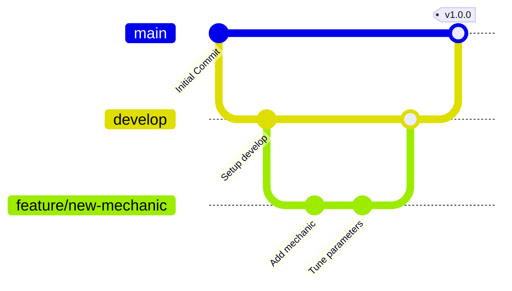

# Operation 1989

A 3D interactive simulation project built with Unity 6 and the Universal Render Pipeline (URP).

---

## 📌 Project Overview

- **Unity Version:** `6000.6.3f1` (Unity 6)
- **Render Pipeline:** Universal Render Pipeline (URP `17.6.0`)
- **Input System:** Unity Input System (`com.unity.inputsystem` `1.20.0`)
- **Target Platforms:** PC / Standalone (with Mobile URP quality tier support)

---

## 🚀 How to Open and Run the Project

### 1. Prerequisites
- **Unity Hub** (Latest version recommended)
- **Unity Editor `6000.6.3f1`** (Install via Unity Hub)
- **Git** with **Git LFS** installed (`git lfs install`)

### 2. Opening the Project
1. Open **Unity Hub**.
2. Click **Add** > **Add project from disk**.
3. Select the repository root folder (`1989`).
4. Ensure the Editor version is set to **`6000.6.3f1`** and open the project.
5. Wait for Unity to import packages and compile shaders/assets on first launch.

### 3. Running the Main Scene
1. In the **Project** window, navigate to:
   ```
   Assets/army base.unity
   ```
2. Double-click **`army base`** to load the scene.
3. Click the **Play** button at the top of the Unity Editor.

### 4. Player Controls
| Action | Input (Keyboard & Mouse) |
|---|---|
| **Move** | `W` / `A` / `S` / `D` |
| **Look / Rotate Camera** | Mouse Movement |
| **Jump** | `Space` |
| **Sprint / Run** | `Left Shift` |
| **Lock / Unlock Mouse Cursor** | Click game view / `Esc` |

---

## 📁 Folder Structure

```
1989/
├── .gitattributes                # Line ending normalizations and Git LFS rules
├── .gitignore                    # Excludes Unity/IDE generated files (Library, Temp, Logs, etc.)
├── README.md                     # Project documentation
├── Packages/                     # Unity package manifest and dependency locks (Tracked)
│   ├── manifest.json
│   └── packages-lock.json
├── ProjectSettings/              # Editor, physics, graphics, and quality settings (Tracked)
│   ├── EditorBuildSettings.asset
│   ├── GraphicsSettings.asset
│   ├── QualitySettings.asset
│   ├── ProjectVersion.txt
│   └── ...
└── Assets/                       # Source game assets, scripts, and scenes (Tracked with .meta)
    ├── InputSystem_Actions.inputactions # Input Action asset
    ├── Settings/                 # URP pipeline assets, renderers, and volume profiles
    │   ├── PC_RPAsset.asset
    │   ├── Mobile_RPAsset.asset
    │   └── UniversalRenderPipelineGlobalSettings.asset
    ├── Scenes/                   # Default scenes directory (legacy template)
    ├── TutorialInfo/             # URP onboarding and tutorial scripts
    ├── Scripts/                  # Gameplay and agent controllers
    ├── Prefabs/                  # Reusable gameplay prefabs
    ├── Flooded_Grounds/           # Environment assets
    └── army base.unity            # Military-base environment scene
```

> **Note on Ignored Folders:**  
> Generated folders such as `Library/`, `Temp/`, `Obj/`, `Logs/`, `UserSettings/`, and IDE-generated solutions (`*.sln`, `*.csproj`, `.vs/`) are strictly ignored via `.gitignore` and should never be checked into source control.

---

## ⚙️ Current Setup & Technical Stack

1. **Rendering & Quality**:
   - Configured with Universal Render Pipeline (URP 17.6.0).
   - Dedicated **PC** (`PC_RPAsset`) and **Mobile** (`Mobile_RPAsset`) quality tiers in `QualitySettings.asset`.
   - Linear color space with forward rendering and HDR support.
2. **Environment**:
   - The active military-base environment is in `Assets/army base.unity`.
3. **Character Controller & Input**:
   - First-person exploration controller integrated with the **New Input System** (`com.unity.inputsystem`).
   - Supports head-bobbing, dynamic footstep audio, and smooth mouse-look dampening.
4. **Version Control Settings**:
   - Asset Serialization set to **Force Text** (`m_SerializationMode: 2`).
   - Version Control mode set to **Visible Meta Files**.

---

## 🌿 Team Git Workflow

To maintain repository stability and prevent asset serialization conflicts, follow these team workflow rules:

### Branching Strategy
- **`main`**: Production-ready, stable releases. Protected branch.
- **`develop`**: Active integration branch for team collaboration. All feature branches branch off and merge back here.
- **`feature/<feature-name>`**: New gameplay mechanics, environment areas, or UI features.
- **`fix/<bug-name>`**: Bug fixes and configuration corrections.



### Git Rules for Unity Development
1. **Always Commit `.meta` Files**: Every asset inside `Assets/` must be committed with its corresponding `.meta` file in the same commit.
2. **Never Move/Delete Files Outside Unity**: Rename and move assets inside the Unity Editor to allow Unity to update `.meta` GUIDs and internal references automatically.
3. **Use Git LFS**: Ensure Git LFS is installed and initialized before pushing textures, 3D models, or audio clips.
4. **Avoid Simultaneous Scene Edits**:
   - Break large levels into **Prefabs** and edit prefabs in Prefab Mode.
   - Use additive scene loading if multiple team members work on the environment simultaneously.
5. **Pre-Push Validation**: Always verify that the project compiles cleanly in Unity Editor with **zero console errors** before pushing to `develop` or creating a Pull Request.

---

## 🔍 Setup Review & Identified Issues

During the setup review, the following points were identified and resolved/documented:

| Component | Status | Details |
|---|---|---|
| **`EditorBuildSettings.asset`** | Cleaned | Removed the deleted environment scene entry; no scenes are currently configured for builds. |
| **`.gitignore`** | ⚠️ Resolved | No `.gitignore` existed previously. Added comprehensive Unity-tailored `.gitignore` excluding `Library/`, `Temp/`, `Logs/`, `UserSettings/`, and IDE files. |
| **`.gitattributes`** | ⚠️ Resolved | Created `.gitattributes` to handle LF line endings for text/YAML files and configure Git LFS tracking for binary assets (`.fbx`, `.png`, `.tga`, `.wav`, etc.). |
| **Meta File Integrity** |  Verified | Scanned all assets in `Assets/`; confirmed 100% paired `.meta` files with zero missing or orphaned metadata. |
| **Serialization Mode** |  Verified | `EditorSettings.asset` is correctly configured with `m_SerializationMode: 2` (Force Text) and `VersionControlSettings.asset` is set to `Visible Meta Files`. |
>>>>>>> 23a143c (chore(setup): configure .gitignore, .gitattributes, EditorBuildSettings, and add README documentation)
